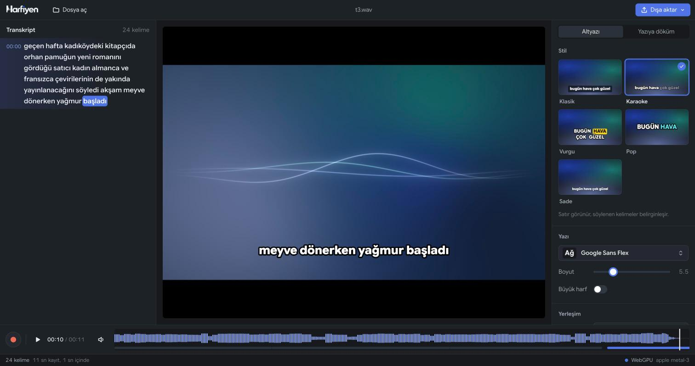

<p align="center">
  <picture>
    <source media="(prefers-color-scheme: dark)" srcset="public/brand/harfiyen-logo-light.png" />
    
  </picture>
</p>

<p align="center">
  <strong>Türkçe ve İngilizce konuşmayı tarayıcıda yazıya döker, çevirir, yapay sesle seslendirir ve altyazıyı videonun içine yazar.</strong><br />
  Ses ve video bilgisayarından çıkmaz. 
</p>

<p align="center">
  Turkish and English speech-to-text, translation, synthetic-voice dubbing and styled video captions, right in your browser.<br />
  Transcribe files or live audio, translate, dub, and export captioned videos — all processed locally.
</p>

<p align="center">
  <code>WebGPU</code> · <code>Türkçe</code> · <code>Lokal İşleme</code> · <code>Altyazı Stilleri</code> · <code>Canlı Mikrofon</code>
</p>

<p align="center">
  <a href="https://harfiyen.dev"><strong>harfiyen.dev</strong></a> ·
  <a href="#hızlı-başlangıç">Hızlı başlangıç</a> ·
  <a href="#neler-yapabilir">Özellikler</a> ·
  <a href="#kullanım">Kullanım</a> ·
  <a href="#yapılacaklar">Yapılacaklar</a>
</p>

<p align="center">
  
</p>

https://github.com/user-attachments/assets/72944ea4-75aa-4462-b5eb-b98a2f604bfc

---

Harfiyen, [seda-v0.2](https://huggingface.co/atasoglu/seda-v0.2) Türkçe konuşma tanıma modelini doğrudan
tarayıcıda, ekran kartı üzerinde (**WebGPU**) çalıştırır. Daha yüksek doğruluk için
[Whisper large-v3 turbo](https://huggingface.co/openai/whisper-large-v3-turbo), ekran kartı olmayan cihazlarda da
[Duyu-small](https://huggingface.co/KaanAydinli/Duyu-small) seçilebilir. Bir video ya da ses dosyası yüklersin,
istersen kadrajını (örneğin dikey 9:16) ve kullanacağın bölümü seçip **Yazıya dök** dersin; kelimeler zaman
kodlarıyla belirir, istediğin altyazı stilini seçersin ve altyazılı videoyu indirirsin. Mikrofonla konuşurken de
canlı çalışır.

## Neler yapabilir

### Yazıya döküm

- Video ve ses dosyaları: MP4, MOV, MKV, WebM, MP3, M4A, WAV, FLAC, OGG. Uzun dosyaları parça parça işler,
  bellek şişmez.
- Döküm düğmeyle başlar: dosya açılınca ses grafiği çizilir, döküm beklemede kalır. Önce istersen kadraj ve
  bölüm seçilir, sonra **Yazıya dök**. Bölüm seçildiyse yalnızca o kısım dökülür; 20 dakikalık videodan
  30 saniye seçilince yalnızca 30 saniye işlenir. Döküm ilerledikçe ses grafiğinde dökülen kısım rengine
  kavuşur.
- Canlı mikrofon: kelimeler konuştuktan yaklaşık bir saniye sonra belirir, kayıt aynı anda saklanır.
- Durdur, devam et, iptal: döküm durdurulunca o ana kadar yazılan proje olarak kalır ve sonra kaldığı yerden
  sürdürülebilir; sayfa yenilense de kalınan yer unutulmaz. Yanlış dosya **İptal** ile bırakılır, uzun işlerde
  önce onay sorulur.
- Döküm sürerken önizleme yazılanı takip eder: görüntü ve altyazı o an yazılan yeri gösterir. Oynatınca ya da
  sarınca takip durur.
- **Videodaki dil:** Türkçe ya da İngilizce, yazıya dökmeden önce seçilir ve projeyle saklanır. İngilizceyi
  yalnızca Whisper anlar (ekran kartı gerekir); İngilizce seçilince model Whisper Turbo Hafif'e geçer. İngilizce
  transkriptte Türkçe sayı kuralları uygulanmaz; İngilizce seslendirme doğrudan transkripti okur. İngilizce video
  Türkçeye çevrilip Türkçe altyazı ve Türkçe seslendirme (voice-over) yapılabilir.
- Üç model, üst çubuktan (telefonda **⋯** menüsünden) seçilir:
  - **Seda** (varsayılan, ~190 MB): küçük ve hızlı, canlı mikrofonda ve her cihazda çalışır. Üç doğruluk
    ayarı var: **Hızlı**, **Dengeli** ve dil modeliyle **En doğru**. Dosyaları daha doğru olan 5,12 saniyelik
    parçalarla, mikrofonu anında yazmak için 0,64 saniyelik parçalarla işler (aynı model, iki ayrı dışa aktarım).
    Cümleler ses etkinliği algılayıcıyla (Silero VAD) bulunan kısa duraklamalarda kesinleşir.
  - **Duyu** (~85 MB): ekran kartı istemez, işlemcide çalışır; noktalamayı ve büyük harfleri kendisi yazar.
    Yalnızca dosyalarda çalışır, canlı kayıtta kullanılmaz; sesi 12–15 saniyelik parçalar hâlinde işler.
  - **Whisper Turbo** (~1,5 GB) ve **Whisper Turbo Hafif** (~600 MB, 4 bit encoder): daha az hata,
    noktalamayı, büyük harfleri ve rakamları kendisi yazar. Hafif sürüm zor seste biraz daha fazla hata
    yapabilir. Yalnızca dosyalarda ve ekran kartında (WebGPU, `shader-f16`) çalışır; sesi 30 saniyelik
    parçalar hâlinde işler. Sessiz bölümlerde metin uydurmaması için ses etkinliği algılayıcı (Silero VAD)
    kullanır.
- Otomatik noktalama ve büyük harf: döküm bitince seda-v0.2'nin formatter modeli nokta, virgül ve soru işareti
  ekler; cümle başlarını, özel adları ve kısaltmaları büyük harfle yazar, özel ad eklerini kesme işaretiyle ayırır
  ("İstanbul'da", "TBMM'de", "Ahmet Bey'in"). Kelime zamanları korunur; işlem ⌘Z / Ctrl+Z ile geri alınabilir.
- Sayı yazımı: sayılar **kurala göre** (TDK'ya göre: 1–9 yazıyla, 10 ve üstü rakamla) ya da **hepsi
  rakamla** yazılır, istenirse hiç dokunulmaz. Ekler, sıra sayıları, tarih ve saat de doğru yazılır
  ("Saat 15.30'da 15 kişi geldi").
- Kelime düzeyinde zaman: bir kelimeye tıkla, kayıt o ana atlasın; çalarken konuşulan kelime vurgulanır.
- Düzenleme: satıra çift tıkla ve düzelt, satırı sil, ⌘Z ile geri al. Değişmeyen kelimelerin zamanları
  korunur.
- Zaman düzenleme: transkriptte satırın üstüne gelip saat simgesine tıkla. Satırın ya da seçilen tek kelimenin
  başlangıç ve bitiş zamanı yazılarak, ±0,1 sn (Shift ile 0,5) adımlarla ya da **Şu an** ile oynatıcının bulunduğu
  ana getirilerek değiştirilir; **Alt + ← / →** kaydırır. Satır uzayıp kısalınca kelimeleri aynı oranda yayılır.
  Zamanlar önceki ve sonraki kelimeleri geçmez; bitişik kelime aradaki sınırla birlikte uzar ya da kısalır.
  **Metin → Zamanlama** bütün altyazıyı çevirisiyle birlikte 0,1 / 0,5 sn öne ya da geriye alır (**[** ve **]**,
  Shift ile 0,5 sn). Hepsi ⌘Z / Ctrl+Z ile geri alınır. ([emguts/harfiyen](https://github.com/emguts/harfiyen)
  fork'undan uyarlandı.)
- Metni sese hizala: elindeki doğru metni (şarkı sözü, konuşma metni, şiir) transkriptin başlığındaki düğmeyle
  yapıştır. Kelimeler metinden, zamanlar dökümden gelir: metin dökümle yazılışa göre eşleştirilir, yanlış duyulmuş
  ama yakın yazılan kelimeler de eşleşir; eşleşmeyenler komşularının arasına konuşma hızında dizilir. Kısa satırlı
  metinlerde (şarkı sözü, şiir) her satır ayrı bir altyazı satırı olur, altyazı stilleri de orada kırılır;
  paragraflarda kapalı gelir, istenirse değiştirilir. `[Nakarat]`, `(x2)` gibi tek başına duran başlıklar atlanır.
  **Sesle ince ayar** açıkken Whisper metnin kelimelerini en fazla 30 saniyelik parçalarda doğrudan seste arar;
  dökümün kaçırdığı kelimeler de gerçek zamanlarını alır. Eşleşen kelimelerden 2 saniyeden fazla sapan parçalar
  eski zamanlarında kalır. Şarkılarda ve gürültülü kayıtlarda fark eder; daha yavaştır. Dökümün hiç duymadığı
  bölümler için **Elle tempo tut**: kayıt baştan (kesilmişse bölümün başından) çalar, her satır (satır kırma kapalıysa
  her cümle) başlarken **Enter**'a basılır. **Backspace** son işareti siler, **←** / **→** 5 saniye sarar (geri
  gidince sonraki işaretler silinir), **Boşluk** duraklatır, **+** / **−** tepki payını 25 ms değiştirir (her basıştan
  düşülür, varsayılan 150 ms), **Esc** bitirir. Satırın içindeki kelimeler o aralıkta duyulan kelimelerin zamanını
  alır; işaretlenmeyen satırlar sonuncunun ardına dizilir. ⌘Z / Ctrl+Z geri alır. ([emguts/harfiyen](https://github.com/emguts/harfiyen) fork'undan uyarlandı.)
- Bul ve değiştir (⌘F / Ctrl+F): yanlış tanınan bir kelimeyi ya da ismi bütün transkriptte düzelt. Büyük/küçük
  harfe bakmaz, istenirse yalnızca tam kelimeleri bulur.
- SRT ve VTT açma: hazır altyazı açılıp stillendirilir ve videoya yazılır. Satırlar ve zamanlar korunur;
  düzeltilen altyazı aynı satırlarla yeniden indirilebilir. UTF-8 dışında Windows-1254 kodlu dosyalar da
  okunur.

### Altyazı

- On bir stil, üç grupta:
  - **Sakin:** **Klasik** (koyu kutuda iki satır), **Sade** (kutusuz, hafif gölgeli), **Cam** (arkadaki
    video buzlu camla bulanıklaşır).
  - **Vurgulu:** **Karaoke** (söylenen kelimeler belirginleşir), **Dolgu** (söylenen kelime konuşma hızında
    soldan sağa renkle dolar), **Akış** (kelimeler söylendikçe yerinde belirir), **Odak** (kelimeler
    bulanıktan netleşir), **Vurgu** (konuşulan kelime renkli kutuda).
  - **İri:** **Pop** (ortada iri, zıplayan kelimeler), **Tek kelime** (ortada yalnızca söylenen kelime),
    **Netleş** (tek iri kelime bulanıktan netleşerek gelir).
- **Sesle vurgula:** çevresindekilerden yüksek sesle söylenen kelimeler büyük ve vurgu renginde yazılır.
- On yazı tipi, hepsi Türkçe karakterlerin tamamıyla: Google Sans Flex, Montserrat, Poppins, Inter, Anton,
  Bebas Neue, Bangers, Luckiest Guy, Schibsted Grotesk, Literata. Kendi yazı tipin de (TTF, OTF, WOFF, WOFF2)
  eklenebilir; tarayıcıda saklanır.
- Boyut, konum, zemin (kutu, kontur, gölge), yazı ve vurgu rengi, Türkçe kurallarına uygun büyük harf
  (i → İ).
- **Altyazıyı göster** kapatılırsa oynatıcıda ve videoda altyazı olmaz; seslendirmeli ama altyazısız video çıkarmak
  için. Seçim projeyle saklanır, yeni projeler altyazılı başlar. SRT/VTT etkilenmez.
- Logo: kendi logon (PNG, SVG, WebP, JPEG) seçtiğin köşede, istediğin boyut ve saydamlıkta durur. Bu
  tarayıcıda saklanır, sonraki projelerde de hazırdır; her projede gizlenebilir.

### Sahne ve kinetik tipografi

- **Sahne** sekmesinde ekrandaki yazı seçilir: **Altyazı**, **Kinetik** ya da **Yok**. Arkasında ne olacağı da
  buradan seçilir: videolarda görüntünün kendisi ya da bulanık hâli, ses dosyalarında bir aura ya da düz zemin.
  Videonun görüntüsü yerine aura da konabilir; o zaman dosyanın yalnızca sesi kullanılır.
- **Kinetik tipografi** altyazı yerine bütün ekranı kullanır. Sekiz stil var:
  - **3D Düğüm:** satır, kendi etrafında dönen bir 3D düğümün üzerinde akar.
  - **Pano:** havalimanı kalkış panosu gibi her satır tık tık dönerek yerine oturur.
  - **Fizik (Matter.js):** söylenen her kelime sahneye düşer, çarpar, devrilir ve üst üste yığılır.
  - **2D Kamera:** her cümle iki yana yaslı bir blok olur, cümle bitince kamera dönerek sıradakine geçer.
  - **Poster:** arkada dev hayalet tipografi, ortada farklı ölçeklerde dizilen poster bloğu.
  - **Darbe:** sesin enerjisiyle büyüyen tam ekran kelimeler.
  - **Maske:** harfler görünmez bir çizginin arkasından yükselir, söylenen kelimenin altı dolar.
  - **Tünel:** kelimeler uzaktan gelir, söylenirken durur, sonra kameranın içinden geçip gider.
- Beş renk paleti (Gece & Altın, Siyah & Neon, Krem & Mürekkep, Mercan & Beyaz, Çini & Firuze) ve bütün yazı
  tipleri (yüklediklerin de) seçilebilir. Oynatıcıda ve altyazılı MP4'te aynı görünür.
- **Auralar:** **Aura** (yumuşak gradyan ve dalga çizgileri), **Halo** (sesin frekanslarıyla bükülen halkalar),
  **Ufuk** (sesin son saniyeleri üzerinde uçulan retro dalga arazisi), **Küre** (sesle şekil değiştiren yanardöner
  3D damla) ve **Sırtlar** (üst üste dizilmiş ışık çizgileri). Beş renk paleti var: Çini, Gün batımı, Orman,
  Lavanta, Gece.
- **Fotoğraf:** arka plan olarak kendi fotoğrafın (JPEG, PNG, WebP; örneğin podcast kapağı) kareyi kaplar, taşan kısmı
  kesilir. **Net** ya da **Bulanık** seçilir; bulanıkta yazı her fotoğrafta okunur. Kinetik tipografi üstünde ince bir
  perdeyle durur. Fotoğraf bu tarayıcıda saklanır, sonraki projelerde de hazırdır; videolarda seçilince videonun
  yalnızca sesi kullanılır.

### Görüntü ve dışa aktarma

- WebGPU oynatıcı: önizlemede gördüğün, dışa aktarılan videonun birebir aynısıdır.
- Kadraj: oynatıcının üstündeki kırpma düğmesiyle (ya da **C**) 9:16, 4:5, 1:1, 16:9 ya da serbest oran.
  **Doldur** kareyi kaplar; kutu sürüklenir, köşelerinden boyutlandırılır, taşan kısım kesilir. **Sığdır**
  videonun tamamını karenin içine sığdırır; boşluklar bulanık ya da siyah olur. Altyazı yeni kareye göre
  yerleşir. 4K yatay videodan 9:16 kadrajla 1080×1920 dikey video (Reels, Shorts) çıkar; dışa aktarma menüsü
  9:16'da 1080p'yi önerir.
- Kesme: zaman çizelgesinin sonundaki **Kes** ile videonun bir bölümü seçilir; seçilen kısım renklenir, uçlar
  sürüklenince oynatıcı o kareyi gösterir. Yalnızca o bölüm yazıya dökülür, oynatılır ve dışa aktarılır; video,
  SRT ve VTT zamanları 0:00'dan başlar. **Tamam**'dan sonra zaman çizelgesi yalnızca seçilen bölümü kaplar
  (transkript ve oynatıcıdaki zamanlar dosyanınki olarak kalır); **Kes**'e yeniden basınca bütün dosya görünür.
- Boşlukları kesme (jump cut): **Metin** sekmesinde **Sessizlikleri at** açılınca kelimeler arasındaki uzun
  sessizlikler videodan çıkar, cümleler arka arkaya gelir. Sessizlikler transkriptin kelime zamanlarından bulunur,
  sesin düzeyiyle inceltilir: transkriptte olmayan bir ses (gülme, öksürük) kesilmez. **En kısa** kaç saniyelik
  sessizliğin kesileceğini, **Pay** konuşmanın iki yanında ne kadar sessizlik kalacağını belirler; "ııı", "eee",
  "hmm" gibi dolgu sesleri de istenirse kesilir ve altyazıda görünmez. Oynatırken kesilen yerler atlanır, zaman
  çizelgesinde soluk görünür. Video, SRT ve VTT kesilmiş hâliyle dışa aktarılır, sesin her kesimde birkaç
  milisaniyelik geçişi olur. Seslendirme açıksa okunan cümlelerin altı kesilmez. Transkript ve zamanları
  değişmez; kapatınca video eski hâline döner.
- Altyazılı MP4: kareler ekran kartında birleştirilir, video H.264 ya da HEVC olarak kodlanır, ses kopyalanır.
  Tarayıcı destekliyorsa ekran kartı, desteklemiyorsa işlemci kullanılır; menü hangisinin kullanılacağını gösterir.
- Dışa aktarırken çözünürlük (kaynakla aynı, daha küçük ya da 1080p'ye kadar daha büyük) ve kalite seçilir;
  tahmini dosya boyutu seçim yapılırken görünür. 1080p'den küçük videolar varsayılan olarak 1080p yazılır:
  görüntü büyütülür, altyazı bu boyutta çizildiği için keskin çıkar.
- Ses dosyaları ve kayıtlar aura ya da kinetik tipografiyle (bkz. Sahne ve kinetik tipografi) altyazılı MP4
  olarak 720p, 1080p ya da 4K dışa aktarılabilir.
- Ses düzeyi: oynatma çubuğundaki ses düğmesinin üstüne gelince kaydırıcı açılır. Seslendirmeyi ve orijinal sesi
  birlikte kısar, düzey tarayıcıda hatırlanır; dışa aktarılan videoyu etkilemez.
- SRT, WebVTT, düz metin, kelime zamanlı JSON ve panoya kopyalama.

### Seslendirme

- **Türkçe:** Transkript, [EMA Lightning](https://huggingface.co/canberkkkkkk/ema-lightning),
  [Antalia Mini](https://huggingface.co/cloud0day3/antalia-mini),
  [Ahenk Cep](https://huggingface.co/ozgurguler/ahenk-cep-tr) ya da
  [Supertonic 3](https://huggingface.co/Supertone/supertonic-3) ile yapay bir Türkçe sesle yeniden okunur. Her
  altyazı satırı kendi zamanında başlar; yerine sığmayan satır en fazla 1,35 kat hızlı okunur. Ahenk Cep rakamları,
  tarihleri ve kısaltmaları en iyi okuyan sestir; diğerlerinden biraz yavaştır.
- **İngilizce (voice-over):** İngilizce çeviri Supertonic 3 ile okunur. Çeviri yoksa **Çevir ve seslendir** önce
  çevirir, sonra okur; ilerleme tek çubukta görünür. Her cümle Türkçesinin başladığı anda başlar; sığmayan cümle önündeki sessizliğe biraz erken başlar,
  gerekirse en fazla 1,15 kat hızlı okunur (Supertonic daha hızlıda cümle sonunu yutuyor). On ses arasından
  seçilir (Alex, James, Robert, Sam, Daniel, Sarah, Lily, Jessica, Olivia, Emily).
- **Metin seslendir:** boş ekrandaki **Metin seslendir** ile dosya olmadan, yazılan ya da yapıştırılan metin
  yapay sesle okunur. Kelimeler zamanlarıyla altyazıya ve oynatıcıya yerleşir; aura ya da kinetik tipografiyle
  videoya dönüşür.
- Modellerin cümle başına ve sonuna koyduğu sessizlik kırpılır; böylece cümleler birbirini itmez, seslendirme
  videonun gerisinde kalmaz.
- Videonun (ya da seçili bölümün) sonuna taşan son cümleler önlerindeki duraklamalara doğru geriye kayar, gerekirse
  son 20 saniyedeki cümleler biraz hızlanır. Yine sığmazsa kaç saniye taştığı söylenir; **Cümleye git** ile cümle
  kısaltılabilir, seçili bölüm varsa **Bölümü uzat** ile videonun devamı kullanılır.
- Ses tonu yarım ton adımlarla kalınlaştırılıp inceltilebilir; satırların süresi değişmez (Supertonic'te yok, on
  sesi var). Seed aynı sesi farklı bir vurguyla okutur. Ayarlar seslendirmeden önce ilk satırla dinlenebilir.
- Açıkken oynatıcı ve altyazılı MP4 yapay sesi kullanır. **Orijinal ses** %0 ile %50 arasında ayarlanır: %0'da hiç
  duyulmaz, üstünde yapay sesin altında kısık duyulur (konuşma, müzik ve ortam sesi hafifçe kalır).
- Altyazı seslendirmeyle aynı dildeyse sesi takip eder: her cümle sesinin başladığı ve bittiği anda görünür.
  Oynatıcı, zaman çizelgesi, SRT/VTT ve altyazılı MP4 bu zamanları kullanır; transkript orijinal zamanlarda kalır.
- Seslendirme projeyle birlikte tarayıcıda saklanır: proje yeniden açılınca hazırdır, ses ayarı da onunla gelir.
  Transkript ya da çeviri sonradan değiştiyse eskidiği söylenir. 10 dakikalık bir video için yaklaşık 40 MB yer tutar.
- Yapay ses ayrıca WAV olarak indirilebilir (orijinal ses karışmadan). Modeller ilk kullanımda indirilir:
  EMA Lightning yaklaşık 36 MB, Antalia Mini 23 MB, Ahenk Cep 18 MB, Supertonic 3 203 MB.

### Çeviri

- Türkçe transkript [opus-mt-tc-big-tr-en](https://huggingface.co/Helsinki-NLP/opus-mt-tc-big-tr-en) ile
  İngilizceye, İngilizce transkript [opus-mt-tc-big-en-tr](https://huggingface.co/Helsinki-NLP/opus-mt-tc-big-en-tr)
  ile Türkçeye, cümle cümle çevrilir. Her cümle aslının zamanında görünür; kelimeleri o süreyi uzunluklarına göre
  paylaşır.
- Transkriptin üstündeki **TR / EN** ile gösterilen dil seçilir: altyazı, zaman çizelgesi, SRT/VTT/metin ve
  altyazılı MP4 o dilde olur (çeviride dosya adına `.en` ya da `.tr` eklenir). Çeviri de düzenlenebilir, bulup
  değiştirilebilir.
- Çeviri seslendirmeyle sesli de okunabilir: Türkçe videoya İngilizce, İngilizce videoya Türkçe voice-over
  (bkz. Seslendirme).
- Çeviri projeyle birlikte kaydedilir. Transkript sonradan değişirse çevirinin eskidiği söylenir.
  Her yönün modeli ilk kullanımda yaklaşık 360 MB indirir ve işlemcide (WASM) çalışır.

### Konuşmacılar

- **Metin** sekmesindeki **Konuşmacıları ayır** kimin ne zaman konuştuğunu sesinden bulur. Konuşmalar her
  kelimenin zamanından bulunur, her 1,5 saniyelik parçanın ses izi
  [3D-Speaker CAM++](https://www.modelscope.cn/models/iic/speech_campplus_sv_zh_en_16k-common_advanced) ile
  çıkarılır, izler kişilere göre gruplanır. Kaç kişi konuştuğu seçilebilir ya da bulunması istenebilir; biliniyorsa
  seçmek sonucu iyileştirir. Konuşmacılar "Konuşmacı 1", "Konuşmacı 2" diye adlandırılır, kim olduklarını sistem
  bilmez.
- Transkriptte her konuşmanın başında konuşanın adı renkli yazar; satırlar konuşmacı değişince bölünür. Ada
  tıklayınca o konuşma, satırın üstündeki kişi düğmesiyle tek satır başka birine ya da yeni bir konuşmacıya
  verilir. Adlar değiştirilir; aynı kişi iki kez çıktıysa ikisi birleştirilir. Hepsi ⌘Z ile geri alınır.
- **Altyazı** sekmesindeki **Konuşanın adını göster** açılınca konuşan değiştiğinde altyazının üstünde adı, renk
  noktasıyla çıkar. Ad, stilin kendi görünümünü alır: kutulu stilde küçük bir kutu, konturluda kontur, gölgelide
  gölge, camda yarı saydam bir zemin; yazı ve vurgu renkleri değişmez. Kinetik tipografide stillerin düzenine
  karışmamak için ad her stilde sol üst köşede durur, konuşan değişince yenisine geçer. Oynatıcı ve altyazılı MP4
  aynıdır; tek konuşmacıda ad gösterilmez.
- Konuşmacılar zaman aralığı olarak saklanır: transkript düzeltilse, çevrilse ya da boşluklar kesilse de her kelime
  konuşanını bulur. SRT'de konuşan değiştiği satırın başına adı yazar ("Ayşe: …"), WebVTT'de ses etiketi
  (`<v Ayşe>`) kullanılır, düz metin ve JSON'da da adlar yer alır. Konuşmacılar projeyle ve **.harfiyen**
  dosyasıyla kaydedilir.
- Model ilk kullanımda yaklaşık 28 MB indirir ve işlemcide (WASM) çalışır; bir dakikalık ses birkaç saniyede biter.

### Projeler

- Otomatik kayıt: transkript, düzeltmeler, altyazı stili, kadraj, seçilen bölüm ve dalga formu tarayıcıda
  (IndexedDB) saklanır; sekme kapansa da kaybolmaz. Henüz yazıya dökülmemiş dosyalar da projelerde durur.
- Son projeler **Projeler** menüsünde ve boş ekranda listelenir; tek tıkla model yeniden çalışmadan açılır.
  Projeler yeniden adlandırılabilir ve silinebilir.
- Medya kopyalanmadan bağlanır: Chrome ve Edge dosyanın kendisine erişim izni saklar, diğer tarayıcılar
  1 GB'a kadar dosyaların kopyasını tutar. Tarayıcı izin isterse ya da dosya bulunamazsa tek düğmeyle yeniden
  bağlanır; kelime zamanları korunur.
- **.harfiyen** proje dosyası: projeyi dosya olarak indir, başka zaman ya da başka tarayıcıda aç. Medya
  dosyası içine eklenmez, açarken bir kez seçilir.

### Ayarlar ve modeller

- **Ayarlar → Görünüm:** açık ya da koyu tema; varsayılan olarak bilgisayarın ya da telefonun teması izlenir.
  Oynatıcının çevresi her iki temada da koyu kalır.
- **Ayarlar → Modeller:** her modelin indirilip indirilmediği ve ne kadar yer kapladığı görünür. Modeller
  tek tek indirilip silinebilir; bu cihaza uygun olanların hepsi tek düğmeyle indirilir. Başka bir modelin
  de kullandığı dosyalar silinmez.
- Büyük modeller 32 MB'lık parçalar hâlinde iner ve saklanır; bağlantı koparsa ya da sekme kapanırsa indirme
  kaldığı yerden sürer.
- Modeller tarayıcının bu siteye ayırdığı alanda (Cache Storage) durur. Tarayıcı ayarlarından site verisini
  silmek projeleri de siler; yalnızca modellerden yer açmak için Ayarlar kullanılır.

> Seda küçük harfli, noktalamasız metin üretir; noktalama ve büyük harf ayrı bir modelle sonradan eklenir.
> Sayılar seçilen kurala göre rakama çevrilir.

## Hızlı başlangıç

Gerekenler: Node.js 20+, Python 3.10+ (yalnızca modeli bir kez hazırlamak için) ve WebGPU destekli bir
tarayıcı (masaüstü Chrome veya Edge önerilir).

```bash
npm install
python3 -m pip install -r scripts/requirements.txt
npm run models     # konuşma tanıma, noktalama ve çeviri modellerini indirir ve tarayıcı için dönüştürür (bir kez, Whisper dahil ~3 GB)
npm run dev        # http://localhost:5173
```

İlk açılışta tarayıcı yaklaşık 190 MB indirir (Seda ve ONNX Runtime) ve saklar; sonraki açılışlar
önbellekten, internetsiz çalışır. Whisper Turbo seçilirse ilk dosyada ayrıca yaklaşık 1,5 GB (Hafif: 600 MB), Duyu
seçilirse yaklaşık 85 MB indirilir. Noktalama ilk kullanıldığında ayrıca yaklaşık 30 MB, İngilizce çeviri yaklaşık 360 MB,
İngilizce seslendirme (Supertonic 3) yaklaşık 203 MB indirilir ve önbelleğe alınır. Modeller **Ayarlar → Modeller**'den önceden indirilebilir ya da silinebilir. Ses ve metin
işlenmek için sunucuya gönderilmez.

### Telefondan veya ağdaki başka bir cihazdan açmak

Mikrofon, WebGPU ve çok iş parçacıklı WASM yalnızca güvenli bağlamda çalışır; `localhost` güvenli
sayılır ama `http://192.168.x.x` sayılmaz. Yerel bir sertifika üret, geliştirme sunucusu `.cert/`
klasörünü görünce kendiliğinden HTTPS ile ağa açılır (klasör git'e girmez):

```bash
mkcert -install
mkdir -p .cert
mkcert -cert-file .cert/dev.pem -key-file .cert/dev-key.pem localhost 127.0.0.1 <bilgisayarın-yerel-IP'si>
npm run dev        # https://<bilgisayarın-yerel-IP'si>:5173
```

Telefonda uyarısız açılması için `mkcert -CAROOT` klasöründeki `rootCA.pem` dosyasını cihaza yükleyip
güvenilir yap (iOS: Ayarlar → Genel → Hakkında → Sertifika Güven Ayarları).

## Kullanım

| İşlem                      | Nasıl yapılır                                                                              |
| -------------------------- | ------------------------------------------------------------------------------------------ |
| Dosya açmak                | **Dosya aç** ya da dosyayı pencereye sürükle                                               |
| Yazıya dökmek              | Transkript panelinde **Yazıya dök**; dosya açılınca kendiliğinden başlamaz                 |
| Mikrofonla kayıt           | Alttaki kırmızı düğme ya da **R**                                                          |
| Dökümü durdurmak           | Alt çubukta **Durdur**; sürdürmek için **Devam et**, bırakmak için **İptal**               |
| Oynat / duraklat           | **Boşluk** ya da görüntüye tıkla                                                           |
| 5 sn geri / ileri          | **←** / **→**                                                                              |
| Tam ekran                  | **F** ya da görüntüye çift tıkla                                                           |
| Logo eklemek               | Sağ panelde **Altyazı → Logo → Bilgisayarından logo ekle**                                 |
| Kadraj                     | Oynatıcının üstünde kırpma düğmesi ya da **C**; **Enter** uygular, **Esc** vazgeçer        |
| Bölüm seçmek (kesme)       | Zaman çizelgesinin sonunda **Kes**, uçları sürükle, **Tamam**; oynatırken **I** / **O**    |
| Satırı düzenlemek          | Satıra çift tıkla, **Enter** kaydeder, **Esc** vazgeçer                                    |
| Zamanı düzenlemek          | Satırın üstüne gel, saat simgesi; bütün altyazıyı kaydırmak için **[** / **]**             |
| Metni sese hizalamak       | Transkriptin başlığındaki hizalama düğmesi, metni yapıştır                                 |
| Sessizlikleri kesmek       | Sağ panelde **Metin → Sessizlikleri at**                                                   |
| Konuşmacıları ayırmak      | Sağ panelde **Metin → Konuşmacıları ayır**                                                 |
| Kinetik tipografi, aura    | Sağ panelde **Sahne**                                                                      |
| Metni seslendirmek         | Boş ekranda **Metin seslendir**                                                            |
| Ses düzeyi                 | Alt çubuktaki ses düğmesinin üstüne gel                                                    |
| Geri al                    | **⌘Z** / **Ctrl+Z**                                                                        |
| Otomatik noktalama         | Sağ panelde **Noktalama ve büyük harf → Otomatik ekle** (varsayılan açık; tercih saklanır) |
| Noktalamayı elle uygulamak | Döküm bitince aynı bölümde **Şimdi uygula**                                                |
| Dışa aktarmak              | Sağ üstte **Dışa aktar**                                                                   |
| Kayıtlı projeyi açmak      | **Projeler** menüsü ya da boş ekrandaki **Son projeler**                                   |
| Proje adını değiştirmek    | Üstteki proje adına tıkla, **Enter** kaydeder, **Esc** vazgeçer                            |
| Proje dosyası              | **Projeler → Projeyi dosya olarak indir**; açmak için **Dosya aç** ya da sürükle-bırak     |
| Modelleri yönetmek         | Üst çubukta **Ayarlar → Modeller**                                                         |
| Sürüm ve bağlantılar       | **Ayarlar → Hakkında**                                                                     |

## Performans

Apple Silicon (Metal), Chrome, dil modeliyle beam search:

| İşlem                   | Ölçüm                                                               |
| ----------------------- | ------------------------------------------------------------------- |
| Yazıya döküm            | gerçek zamanın ~12 katı (encoder ~38 ms / 0,64 sn'lik parça)        |
| Videoya altyazı yazma   | 640×360 videoda ~70 kare/sn; sesten 1080p video ~3 kat gerçek zaman |
| İlk açılış              | ~190 MB indirme, sonrası önbellekten                                |
| İlk noktalama kullanımı | ek ~30 MB indirme, sonrası önbellekten                              |

Ölçümler kısa test kayıtlarıyla yapıldı; uzun ve yüksek çözünürlüklü dosyalarda farklı olabilir.

Model kartındaki doğruluk değerleri (WER, düşük olan iyi; FLEURS-TR test). Harfiyen dosyalarda **En doğru** ile
`accurate` kurulumunu kullanır (5,12 saniyelik parçalar, sekiz yollu arama ve dil modeli):

| Kurulum    | seda-v0.1 | seda-v0.2 |
| ---------- | --------- | --------- |
| `fast`     |           | 9,38      |
| `balanced` |           | 7,26      |
| `accurate` | 11,60     | **6,38**  |

## Yayına alma

`npm run build` sonrası `dist/` herhangi bir statik sunucudan yayınlanabilir. Gerekli başlıklar ve Cloudflare
Pages + R2 kurulumu için [docs/DEPLOY.md](docs/DEPLOY.md).

Uygulama bir web manifest'i ile gelir; Chrome ve Edge'de adres çubuğundan masaüstü uygulaması olarak
kurulabilir.

## Geliştirme

```bash
npm run typecheck  # TypeScript kontrolü
npm run test:whisper -- kayit.wav   # Whisper motorunu Node'da dener (16 bit WAV)
npm run test:formatter              # noktalamayı sedalib'in çıktısıyla karşılaştırır (model gerekir)
npm run eval:punct                  # noktalamayı Vikipedi metniyle ölçer (puan verir, model gerekir)
npm run test:numbers                # sayıları rakama çevirme kurallarını dener
npm run test:timing                 # elle zaman düzenlemeyi dener
npm run test:align                  # yapıştırılan metni dökümle hizalamayı dener
npm run test:cuts                   # boşlukları kesmeyi (jump cut) dener
npm run test:speakers               # konuşmacı düzeltmelerini ve dışa aktarımı dener
npm run test:diarize -- ses.wav kim.txt  # konuşmacı ayırmayı bilinen bir kayıtla ölçer (model gerekir)
npm run eval:numbers                # rakama çevirmeyi Vikipedi metniyle ölçer (puan verir)
npm run test:translate -- ref.json  # çeviriyi Python referansıyla karşılaştırır (scripts/make_mt_refs.py)
npm run build      # üretim derlemesi
npm run preview    # derlemeyi lokalinde önizle
```

Arayüz [Tailwind CSS v4](https://tailwindcss.com) ile yazılır (`@tailwindcss/vite` eklentisi):

- `src/index.css`: Tailwind'in giriş dosyası. Preflight (sıfırlama stilleri) kullanılmaz; tasarım
  değişkenleri `@theme` ile Tailwind'e bağlanır (`bg-pane`, `text-fg-2`, `border-line`, `bg-cini`,
  `text-firuze`, `rounded-ui` ...). Animasyonlar ve kaydırıcı / anahtar stilleri de buradadır.
- `src/styles.css`: renk ve yazı tipi değişkenleri ile temel eleman stilleri.
- `src/components/ui.tsx`, `Menu.tsx`, `Dropzone.tsx`, `Indicators.tsx`: ortak bileşenler (düğmeler,
  paneller, form satırları, açılır menüler).

## Bilinen sınırlar

- Altyazılı video oluşturulurken diske yazılır, uzun videolarda da bellek dolmaz: Chrome ve Edge önce kaydedilecek
  yeri sorar, diğer tarayıcılar videoyu tarayıcının kendi disk alanında hazırlayıp indirir. Sayfa ağdan `http://`
  ile açıldığında bu ikisi de kullanılamaz, video bellekte oluşturulur.
- Metni sese hizalamak için önce yazıya dökmek gerekir; zamanlar dökümün duyduğu yerlerden gelir. Dökümün hiç
  duymadığı bölümlerdeki satırlar (başka dilde söylenen kısımlar, müziğin bastırdığı yerler) komşularının yanına
  tahminen yerleşir; **Sesle ince ayar** ya da zaman düzenlemeyle düzeltilir. Sesle ince ayar yalnızca model olarak
  Whisper seçiliyken çalışır (döküm Seda ile yapılmış olabilir) ve ses dosyası gerektirir.
- Zaman düzenleme transkriptten yapılır; zaman çizelgesinde kelime ya da satır kenarlarını sürüklemek yok. Tek
  kelimenin ya da satırın zamanı değişince çevirisi kendiliğinden kaymaz (toplu kaydırma ikisini birlikte kaydırır).
- Kesme tek bölümle sınırlı. Boşlukları kesme yalnızca sessizlikleri ve dolgu seslerini çıkarır; tek tek kesim
  geri alınamaz, transkriptten kelime silerek videodan kesmek yok. Kelime zamanları sessizliği de kapsıyorsa
  (Whisper bazen böyle yapar) o boşluk bulunamaz. Bölüm dökümden sonra genişletilirse eksik kısım için yeniden
  yazıya dökmek gerekir.
- Konuşmacı ayırma üst üste konuşmayı ayırmaz: aynı anda konuşulan yerde kelimeler tek kişiye gider. "Evet",
  "hı hı" gibi kısa araya girmeler ve aynı kişinin çok farklı tonda konuştuğu yerler yanlış kişiye ya da yeni bir
  konuşmacıya düşebilir; transkriptten düzeltilir. Videoda yalnızca ad gösterilir; altyazı rengi ya da konumu
  konuşmacıya göre değişmez, seslendirme her konuşmacıyı aynı sesle okur. Seslendirmeyi takip eden altyazıda
  ad görünmez. Döküm sonradan sürdürülürse yeni kısım için yeniden ayırmak gerekir.
- Kadraj videonun tamamı için sabittir; zamanla kayan kadraj yok. **Sığdır**'da videonun karedeki boyutu ve
  konumu değiştirilemez.
- Seslendirmede Türkçe modellerin tek sesi var; konuşmacılar ayrılmaz, her konuşmacı aynı sesle okunur. Orijinal ses
  yalnızca topluca kısılır; konuşma müzikten ayrılmaz. Dudak hareketleriyle eşleşmez. Seslendirme
  **.harfiyen** proje dosyasına girmez; yalnızca bu tarayıcıda projeyle birlikte saklanır.
- İngilizce seslendirme Türkçeden uzun olabilir; sıkışık konuşmalarda cümleler Türkçesinden birkaç yüz
  milisaniye geç başlayabilir. Seslendirmeyi takip eden altyazıda kelime zamanları harf sayısından tahmin edilir.
- Çeviri yalnızca Türkçe ile İngilizce arasında. Çevrilmiş kelimelerin kendi zamanı yok, bu yüzden "Sesle vurgula" çeviride
  çalışmaz. Yemek adları, özel adlar ve argo yanlış çevrilebilir.
- Ses dosyalarından üretilen MP4'te ses AAC ile kodlanır; tarayıcı AAC kodlayamıyorsa Opus kullanılır.
  Opus'lu MP4'ü QuickTime ve iPhone Fotoğraflar açmayabilir (Chrome, VLC ve sosyal platformlar açar).

## Yapılacaklar

Önerilen öncelik sırasıyla:

- [x] **Projeyi kaydetme ve geri açma:** transkript ve düzeltmeler için otomatik yerel kayıt;
      projeyi dosya olarak indirip yeniden açma.
- [x] **Kelime zamanlarını düzenleme:** başlangıç ve bitiş zamanlarını değiştirme;
      tüm altyazıya toplu zaman kaydırma.
- [x] **Uzun video dışa aktarma:** büyük çıktıları belleği tüketmeden doğrudan diske yazma.
- [x] **Noktalama için Türkçe testleri:** sedalib ile birebir karşılaştırma ve tekrar uygulama;
      Vikipedi metniyle kesme işareti, büyük harf ve noktalama ölçümü.
- [x] **Sayıları rakama çevirme seçeneği:** "bin dokuz yüz yirmi üç" → "1923";
      kurala göre, hepsi rakamla ya da dokunma; tarih ve saat her zaman rakamla.
- [x] **Transkriptte bul ve değiştir:** yanlış tanınan bir kelimeyi veya ismi bütün kayıtta düzeltme.
- [x] **SRT / VTT içe aktarma:** hazır altyazıyı açıp stillendirme ve videoya yazma.
- [x] **Dikey video ve bölüm seçme:** kadraj (Doldur / Sığdır), kesme ve yalnızca seçili bölümü yazıya dökme.
- [x] **İngilizce seslendirme (voice-over):** çeviriyi yapay sesle okuma, orijinal sesi altta tutma, altyazıyı
      sese hizalama.
- [x] **Konuşmacı ayırma:** kimin ne zaman konuştuğunu bulma, transkriptte düzeltme, dışa aktarmada ve videoda
      adlar.
- [ ] **Konuşmacıya göre altyazı ve ses:** altyazı rengi ya da konumu konuşmacıya göre (vurgu rengiyle
      karışmayacak şekilde); seslendirmede konuşmacı başına ses.
- [x] **Jump cut:** sessizlikleri ve dolgu seslerini ("ııı", "eee") kesme.
- [ ] **Transkriptten kesme:** kelime ya da cümle silince videodan da kesilmesi; tek tek kesimi geri alma.
- [ ] **Değişken yazı tipleri için kalınlık ve italik:** yüklenen ve hazır değişken yazı tiplerinde kalınlık
      kaydırıcısı (yazı tipinin kendi aralığında) ve italik anahtarı.

---

## Lisanslar ve teşekkür

Harfiyen [MIT](LICENSE) lisanslıdır; dilediğin gibi kullanabilir, değiştirebilir ve dağıtabilirsin. Bir yerde kullanırsan ya da işine yararsa haber vermen ya da adını anman beni çok sevindirir, ama zorunlu değil.

Lisans Harfiyen'in kendi kodunu kapsar. Aşağıdaki model, veri ve kütüphaneler kendi lisanslarıyla gelir:

- Konuşma tanıma modeli [atasoglu/seda-v0.2](https://huggingface.co/atasoglu/seda-v0.2): CC BY-SA 4.0. Noktalama
  ondaki formatter ile yapılır (CC BY-SA 4.0; [ytu-ce-cosmos/turkish-small-bert-uncased](https://huggingface.co/ytu-ce-cosmos/turkish-small-bert-uncased)
  üzerine, MIT); çalıştırma adımları [sedalib](https://github.com/atasoglu/seda)'den (Apache-2.0) uyarlandı.
- [KaanAydinli/Duyu-small](https://huggingface.co/KaanAydinli/Duyu-small): Apache-2.0.
- [openai/whisper-large-v3-turbo](https://huggingface.co/openai/whisper-large-v3-turbo) (MIT), ONNX
  sürümü [onnx-community](https://huggingface.co/onnx-community/whisper-large-v3-turbo_timestamped);
  kelime zamanlama [openai-whisper](https://github.com/openai/whisper)'dan (MIT) uyarlandı.
- Konuşmacı modeli 3D-Speaker CAM++
  ([iic/speech_campplus_sv_zh_en_16k-common_advanced](https://www.modelscope.cn/models/iic/speech_campplus_sv_zh_en_16k-common_advanced),
  [3D-Speaker](https://github.com/modelscope/3D-Speaker)): Apache-2.0. ONNX sürümü sherpa-onnx'in.
- [Silero VAD](https://github.com/snakers4/silero-vad) v5 (Whisper) ve v6 (Seda, seda-v0.2 ile gelir): MIT.
- Çeviri modelleri [Helsinki-NLP/opus-mt-tc-big-tr-en](https://huggingface.co/Helsinki-NLP/opus-mt-tc-big-tr-en)
  ve [Helsinki-NLP/opus-mt-tc-big-en-tr](https://huggingface.co/Helsinki-NLP/opus-mt-tc-big-en-tr) (OPUS-MT,
  Tatoeba Challenge): CC-BY 4.0. ONNX'e `scripts/prepare_models.py` ile dönüştürülür.
- Seslendirme modeli [canberkkkkkk/ema-lightning](https://huggingface.co/canberkkkkkk/ema-lightning):
  Apache-2.0; metin normalleştirme [normalizer-tr](https://github.com/erdemtuna/normalizer-tr) (Apache-2.0).
- İkinci seslendirme modeli Antalia-2 Mini, Patientdesk.ai,
  [cloud0day3/antalia-mini](https://huggingface.co/cloud0day3/antalia-mini): Apache-2.0 (kod, metin işleme ve
  ağırlıklar). `src/tts/antalia-mini/` altındaki iki dosya modelin Space'inden değiştirilmeden alındı.
- Üçüncü seslendirme modeli [ozgurguler/ahenk-cep-tr](https://huggingface.co/ozgurguler/ahenk-cep-tr):
  ağırlıklar CC BY 4.0. EMA Lightning (Apache-2.0) mimarisinde, Alania verilerinden (PatientDesk AI, CC BY 4.0)
  türeyen Ahenk sesinden öğrenmiş küçük model. Okuma adımları ve metin normalleştirme (`src/tts/trnorm/`)
  [ozguradmin/ahenk-turkish-tts](https://github.com/ozguradmin/ahenk-turkish-tts)'ten (Apache-2.0) uyarlandı.
- Dördüncü seslendirme modeli (İngilizce ve Türkçe) [Supertone/supertonic-3](https://huggingface.co/Supertone/supertonic-3):
  BigScience OpenRAIL-M. Ağırlıklar `scripts/prepare_models.py` ile float16 saklanacak şekilde küçültülür (hesap
  float32 kalır); çalıştırma adımları modelin web örneğinden uyarlandı.
- Dil modeli dosyaları (`rnnlm`, `2gram`): CC BY-SA 4.0 (Türkçe Vikipedi üzerinde eğitildi).
- Noktalama ölçüm metinleri (`tests/data/`): Türkçe Vikipedi, CC BY-SA 4.0; kaynak makaleler dosyalarda.
- Algoritmalar [sherpa-onnx](https://github.com/k2-fsa/sherpa-onnx)'ten (Apache-2.0) uyarlandı.
- [ONNX Runtime Web](https://onnxruntime.ai) (MIT), [mediabunny](https://mediabunny.dev) (MPL-2.0),
  [React](https://react.dev) (MIT), [Tailwind CSS](https://tailwindcss.com) (MIT),
  [Matter.js](https://brm.io/matter-js/) (MIT, kinetik tipografinin Fizik stili).
- Zaman düzenleme, metni sese hizalama ve elle tempo tutma [emguts](https://github.com/emguts)'un
  [emguts/harfiyen](https://github.com/emguts/harfiyen) fork'undan uyarlandı; ses düzeyi kaydırıcısını
  [vuxenn1](https://github.com/vuxenn1) ekledi. Teşekkürler.
- Yazı tipleri: SIL Open Font License 1.1.
